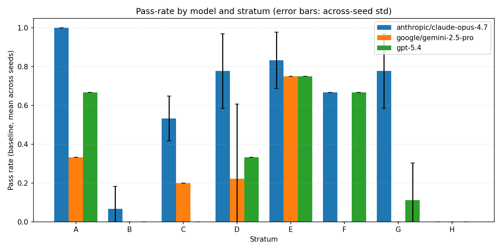
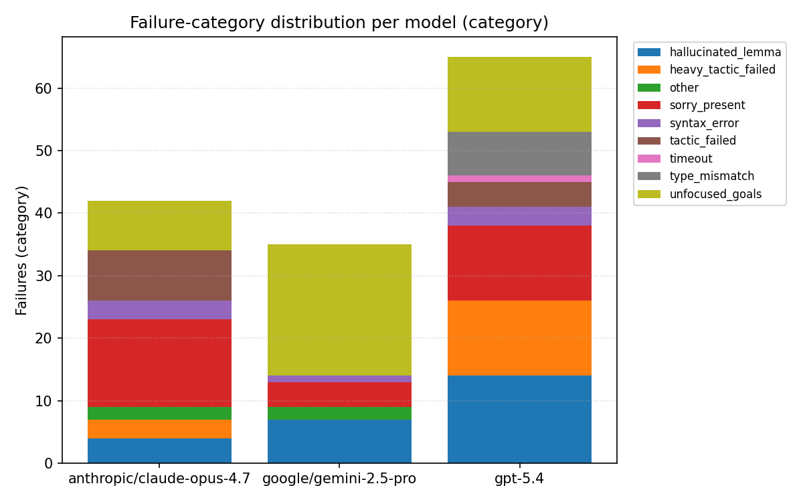

# Diagnosing How Frontier LLMs Fail at Lean

**A miniF2F-v2 evaluation harness for frontier LLMs on formal theorem proving in Lean 4.**
Mukund Ojha, UC Santa Cruz · Paper under review, 2026

Every proof a model writes is checked by the Lean 4 compiler against Mathlib. Nothing is scored by string matching or by another model, so a proof either compiles or it fails.

| | |
| :--- | :--- |
| **Runs** | 222 verified attempts |
| **Problems** | 30 from the miniF2F-v2 test split, in 8 difficulty and contamination strata |
| **Models** | Claude Opus 4.7, GPT-5.4, Gemini 2.5 Pro |
| **Seeds** | 3 per model and problem |
| **Toolchain** | Lean `v4.30.0` with Mathlib, pinned in this repo |

## Key findings

**1. The verification timeout is a measurement choice, and the usual one hides most of the passes.**
At the 180 second timeout used by DeepSeek-Prover-V2 and Goedel-Prover-V2, 24 of Claude's 30 failures were timeouts. Re-verifying the *same generations* at 600 seconds raised the pass rate from **10% (3/30) to 33% (10/30)**, a **3.3x** change with no change to model output. The bottleneck was Mathlib elaborating heavy tactics like `nlinarith`, not the model. Lean evaluations should report pass rates at more than one budget.

**2. Pass rates across the full 30 problem subset (600 second budget):**

| Model | Rows | Pass rate | Std across seeds |
| :--- | ---: | ---: | ---: |
| Claude Opus 4.7 | 90 | **53.3%** | 0.033 |
| GPT-5.4 | 90 | 27.8% | 0.019 |
| Gemini 2.5 Pro | 42 | 16.7% | 0.135 |

At least one model solved 63.3% of the problems, and every model solved 16.7%. Gemini has partial coverage (42 of 90 cells), so read its row as indicative only.



**3. Contamination probes move results in both directions.**
Renaming variables (alpha renaming) doesn't change whether a statement is provable, so a big swing points to memorization.
* Claude solved `amc12b_2004_p3` 2 of 3 times in its original form and 0 of 3 times after renaming.
* GPT-5.4 went the other way: 0 of 3 to 3 of 3 on `mathd_algebra_433`, and 0 of 3 to 2 of 3 on `amc12a_2009_p5`. That fits memorizing an older miniF2F v1 statement that the rename disrupts.
* Reordering hypotheses changed nothing on any problem, so hypothesis order is not a memorization channel.
* The control problem `mathd_algebra_119` stayed at 3 of 3 under every perturbation, so the perturbations don't make easy problems harder.

Full table: [`harness/reports/perturbation_summary.md`](harness/reports/perturbation_summary.md)

**4. The models fail differently.**
Every failure is classified from Lean's compiler output into a taxonomy: hallucinated lemma, failed tactic, unfocused goals, type mismatch, `sorry` left in the proof, syntax error, or timeout. A sample was then hand coded (`coding_sheet.csv`). GPT-5.4 cites lemmas that don't exist in Mathlib far more often than the others, and most of Gemini's failures leave goals unsolved.



## How it works

```
miniF2F-v2 test split ──> 30 problem subset, 8 strata (subset.md)
        │
        ▼
generate.py ──> model proofs (3 seeds, baseline and perturbed variants)
        │
        ▼
run.py ──> lake env lean with a per problem timeout ──> pass or fail + compiler output
        │
        ▼
parse_errors.py ──> failure taxonomy ──> aggregate.py ──> reports, CSVs, plots
```

The strata separate easy sanity checks, hard competition problems, problems whose statement changed between miniF2F v1 and v2 (the contamination probe), and unchanged problems as its control. See [`subset.md`](subset.md) for how each problem was picked.

## Repository layout

| Path | What's there |
| :--- | :--- |
| `harness/scripts/` | Generation, verification, perturbation, error parsing, aggregation and plotting ([details](harness/README.md)) |
| `harness/reports/` | Aggregate reports, including the full 222 run report and the perturbation summary |
| `harness/results_csv/` | Every verified row, plus per model, per stratum and failure breakdowns |
| `harness/plots/` | The figures above |
| `attempts/` | Raw model proof attempts |
| `human_baseline/` | Templates for the human proof baseline |
| `coding_sheet.csv` | Hand coded failure sample |
| `subset.md` | Problem selection and strata rationale |
| `lean-toolchain`, `lakefile.lean`, `lake-manifest.json` | Pinned Lean and Mathlib versions |

## Reproduce it

```bash
# 1. Install elan (https://leanprover.github.io/), then pin and build Mathlib.
lake update
lake build                                  # about 30 minutes the first time

# 2. Fetch the dataset and build the per problem Lean files.
python3 harness/scripts/fetch_dataset.py
python3 harness/scripts/build_problems.py

# 3. Add your API keys. OpenRouter alone is enough.
cp .env.example .env

# 4. Generate proofs, verify them, and aggregate. Each script lists its options with --help.
python3 harness/scripts/generate.py --help
python3 harness/scripts/run.py --help
python3 harness/scripts/aggregate.py --help
```

Input formats and the full workflow are in [`harness/README.md`](harness/README.md).

## Dataset

miniF2F-v2 by Ospanov et al. (2025), [github.com/roozbeh-yz/miniF2F_v2](https://github.com/roozbeh-yz/miniF2F_v2). This repo uses the competition form (v2c) by default.

## License

The code in this repo is MIT licensed (see `LICENSE`). The miniF2F-v2 problems in `datasets/` keep their original license from the miniF2F-v2 authors.
